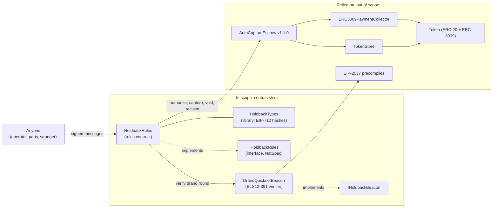
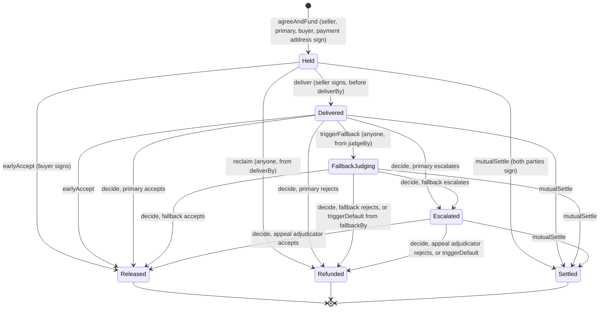

# Audit package: start here

This page is where an outside auditor of Crow's phase-one contracts starts. Crow (protocol name Holdback) is escrow for AI agents: a buyer's funds are held, the seller delivers, an adjudicator the parties chose decides, and the funds are released or refunded. It runs on Ethereum Sepolia with test tokens only.

The code to audit is `contracts/src/` at the git tag `contracts-phase-one-1`. Read these pages from `main`, which corrects them after the tag; `contracts/src/` and `contracts/test/` on `main` equal the tag's.

**The fixed build.** D80 (2026-11-18) has the outside audit read the next build, which carries an outside scan's contract fixes (T-527, T-528 and T-529) on the lane `contracts-audit-ready`. Its tag will be `contracts-phase-one-2`. On the lane, [`state-model.md`](state-model.md), [`threat-model.md`](threat-model.md) TA-11 and the deployer's row, and [`functions.md`](functions.md), "The fixed build", describe it; the dated sections stay records of the tag.

Labels: **measured** (produced by the named command), **documented** (stated in the doc cited), **inferred** (concluded from reading).

## Reading order

1. This page: the system on one page, how to build and test, and the dated figures. The engagement's terms (what to audit, what is excluded, what comes back) are in [`engagement.md`](engagement.md).
2. [`scope.md`](scope.md): what is in scope and out, the cuts phase one made, the dependencies, the trust assumptions and the prior reviews.
3. [`threat-model.md`](threat-model.md): actors, assets, trust boundaries and attack classes.
4. [`state-model.md`](state-model.md): every state a deal can be in on chain, and the signed-field register.
5. [`invariants.md`](invariants.md): each property, the test or model property that checks it, and the recorded runs.
6. [`known-issues.md`](known-issues.md): what is open, accepted or fixed. Do not report these as new.
7. [`events.md`](events.md): every event, who reads it and what it reveals.
8. [`functions.md`](functions.md): each external and public function by caller, input checks, events and calls; the no-admin rule; the static-analysis triage.
9. [`test-quality.md`](test-quality.md): coverage and mutation testing.

## The system on one page

Five files are in scope. `HoldbackRules` is the only contract that changes state. It is the operator of Coinbase's Commerce Payments `AuthCaptureEscrow`, which holds the funds. It moves funds only on a signature it checks (EIP-712, or ERC-1271 for a contract signer) or on a deadline that has passed. No function reads `msg.sender` for authority, so anyone may relay any call.



A deal on chain [documented: [`state-model.md`](state-model.md), section 2]:



The primary may also decide in Held when its call carries the delivery. [`invariants.md`](invariants.md), "Stage transitions", gives every guard.

## Trust assumptions

Each is stated in full in [`scope.md`](scope.md), "Trust assumptions and privileged roles", and [`threat-model.md`](threat-model.md).

- **No admin.** No owner, pause, freeze, blacklist, upgrade proxy, `selfdestruct`, `delegatecall`, `receive` or `fallback`. `contracts/test/fuzz/NoAdmin.fuzz.t.sol` enforces it.
- **The deployer** fixes six constructor arguments of the rules contract once, and on the fixed build one of the beacon's (its pairing gas), and has no authority afterwards.
- **Operators** relay signed messages and hold no role in any contract.
- **Adjudicators** are named by the parties in the terms they both sign. Their decisions are final in phase one, and no adjudicator posts a bond.
- **The token** must be a plain ERC-20 with ERC-3009: no fee on transfer, no rebasing, no hooks. What a token issuer can do to its own token (freeze, pause, blacklist) is out of scope as a finding ([`known-issues.md`](known-issues.md), R-1).
- **drand** supplies the panel seeds for the fallback and an escalation; biasing a round needs a colluding threshold of drand nodes.
- **Commerce Payments** is relied on unchanged. Its published audits are listed in [`docs/reviews/2026-11-03-public-audit-crosscheck.md`](../reviews/2026-11-03-public-audit-crosscheck.md).

## Glossary

The full glossary is in [`docs/architecture.md`](../architecture.md), "Glossary". The words the contracts use:

| Word | Meaning on chain |
| --- | --- |
| Terms | The seller's signed offer: parties, money addresses, price, fee, token, deadlines, adjudicators. Its hash is the commitment ID |
| Hold | The buyer's funds in the escrow for one deal: price plus fee |
| Payment address, payout address | The addresses that fund and receive refunds (buyer side) and that receive payment (seller side); each may differ from the signing address |
| Primary, fallback, appeal adjudicator | The three adjudicators the terms name. The fallback decides when the primary is late; the appeal adjudicator decides after an escalation |
| Escalation | A first decider hands the case to the appeal adjudicator instead of accepting or rejecting |
| Delivery | The seller's signed hash of the work and its encrypted keys |
| Key release | The event that gives the buyer the key to the work, in the same call that pays the seller |
| Default | A refund to the payment address when the deciding adjudicator's window passes |
| Beacon round | The drand quicknet round that seeds a panel; `BEACON_MARGIN` sets how far after a deadline it falls |

## Build and test

Prerequisites: Foundry v1.0.0, the version CI installs (`.github/workflows/ci.yml`, job `contracts`). `foundry.toml` pins the compiler and its settings but not Foundry itself.

```bash
git clone https://github.com/rafaeldavid/holdback
```

```bash
git -C holdback checkout contracts-phase-one-1
```

```bash
git -C holdback submodule update --init --recursive
```

```bash
(cd holdback/contracts && forge build && forge test)
```

- **Submodules.** `contracts/README.md` initialises a shallow subset, which builds and tests. `deploy-sepolia.sh --check` needs the full recursive set to reproduce the exact metadata; the recursive command above completed on 2026-11-17 in several minutes [measured].
- **The full `forge test`** takes 8 to 30 minutes, nearly all in `test/differential/SideBySide.t.sol`. Add `--no-match-path test/differential/SideBySide.t.sol` for a quick run.
- **Coverage.** Plain `forge coverage` fails with "stack too deep", and so does `--ir-minimum` alone. Run `node contracts/scripts/coverage.mjs`, which adds `--ir-minimum` and the exclusions [`test-quality.md`](test-quality.md) explains.
- **Mutation testing:** `node contracts/scripts/mutate.mjs` ([`test-quality.md`](test-quality.md)).
- **Formal model:** `formal/check.sh` fetches a pinned, checksummed TLC into `formal/.tools/` and runs every config; `formal/check.sh safety` runs the safety configs in seconds.
- **Confirm the deployment:** `contracts/script/deploy-sepolia.sh --check <rpc-url>`, from `main`. It only reads. The RPC must serve receipts of old transactions: publicnode does not; Tenderly's public Sepolia gateway does [measured, 2026-11-17].

## Test accounts

- **Local:** the tests derive every key with `vm.addr` in `contracts/test/unit/Base.sol` and run on Foundry's in-process chain (chain ID 31337). No key or RPC is needed.
- **Sepolia:** the deployment's token is tUSDC, which anyone can mint (`contracts/script/TestUSDC.sol`). An auditor who wants to run a deal on Sepolia needs test ETH from a public faucet and any key of their own; the deployer and the operators hold no role.

## Contact

- **The audit engagement:** the repository owner, `rafaeldavid` on GitHub.
- **A vulnerability:** GitHub's private vulnerability reporting, as [`SECURITY.md`](../../SECURITY.md) describes. Do not open a public issue.

## Figures as of 2026-11-17 (T-499)

This section is a dated record. The deployment record, [`contracts/deployments/sepolia.json`](../../contracts/deployments/sepolia.json), stays the source for every address and setting.

### Commits [measured]

| Item | Value |
| --- | --- |
| Tag `contracts-phase-one-1` | `27ab44e8bf359783116a95eb45102c95ce5c3ed6` |
| The record's `commit`, which the deploy built | `938c3fc6b2797c61a3a53a7b00679fbee1cc2906`, an ancestor of the tag with the same build inputs ([`scope.md`](scope.md)) |

### Files in scope [measured: `wc -l`; nSLOC counts non-blank, non-comment lines, and its total equals Aderyn's]

| File | Lines | nSLOC |
| --- | --- | --- |
| `contracts/src/HoldbackRules.sol` | 577 | 370 |
| `contracts/src/HoldbackTypes.sol` | 479 | 358 |
| `contracts/src/IHoldbackRules.sol` | 489 | 110 |
| `contracts/src/DrandQuicknetBeacon.sol` | 181 | 118 |
| `contracts/src/IHoldbackBeacon.sol` | 21 | 5 |
| **Total** | **1,747** | **961** |

### Compiler and dependencies [measured: `foundry.toml`, `git submodule status --recursive`]

- solc 0.8.28, `via_ir`, optimizer on with 200 runs, EVM version prague (for the EIP-2537 precompiles); metadata settings at Foundry's defaults (IPFS hash, CBOR on).
- Commerce Payments v1.1.0 at `6b0a5ef`; Solady 0.1.1 at `5ea5d9f`; OpenZeppelin Contracts 5.0.2 at `1edc2ae` (through spend-permissions 1.0.1 at `8aae4da`); forge-std 1.9.6 at `8ba9031` (tests only); Permit2 at `cc56ad0` (tests only in phase one).

### Deployment on Sepolia (chain ID 11155111) [measured: `sepolia.json`; Sourcify's API v2]

The five contracts' addresses (HoldbackRules, DrandQuicknetBeacon, AuthCaptureEscrow, ERC3009PaymentCollector and TestUSDC, which is out of scope) are in `contracts/deployments/sepolia.json`, which `examples/deployments.ts` (`SEPOLIA`) carries. Each is an exact match on Sourcify at `https://repo.sourcify.dev/11155111/<address>`.

- Each address on Etherscan: `https://sepolia.etherscan.io/address/<address>#code`. Etherscan's verification state was not read: the site refuses scripted requests. Blockscout reports `HoldbackRules` verified [measured].
- Constructor arguments of `HoldbackRules`, in order: the escrow, the collector, an expiry margin of 86,400 s, the beacon, the token, and a beacon margin of 29 s (the record's `contracts.HoldbackRules.args`).
- `deploy-sepolia.sh --check https://sepolia.gateway.tenderly.co` from `main` printed that the record "matches the chain and the build at 938c3fc6…" and exited 0 after 5 min 23 s. It compares each creation transaction's input with this build's creation code plus the encoded constructor arguments.
- Runtime size of `HoldbackRules`: 20,502 bytes on chain and in the build artifact, against the EIP-170 limit of 24,576.

### Tests at the tag, from a clean clone [measured]

| Run | Result | Wall time |
| --- | --- | --- |
| `forge build` | success; 3 warnings, all in `test/` | 16 min on a loaded machine |
| `forge test` | 67 suites, 505 passed, 0 failed, 0 skipped | 29 min 33 s on a loaded machine; CI took 7 min |
| invariant suites (`test/invariant/*`) | 41 passed; 256 runs and 25,600 calls per invariant | see [`invariants.md`](invariants.md) |
| `formal/check.sh`, every config | passed in CI on the tag's commit | CI run `43382656927`, 25 min |

### Coverage at the tag [measured: `forge coverage --ir-minimum` with `coverage.mjs`'s exclusions; 482 tests]

| File | Lines | Statements | Branches | Functions |
| --- | --- | --- | --- | --- |
| `DrandQuicknetBeacon.sol` | 59/59 | 86/86 | 8/8 | 14/14 |
| `HoldbackRules.sol` | 236/237 | 335/336 | 69/70 | 30/30 |
| `HoldbackTypes.sol` | 52/52 | 65/65 | none | 17/17 |

The two interfaces hold no executable code. The one line (`HoldbackRules.sol:165`, a calldata alias) and the one branch (`:236`, the false side of `role == ROLE_PRIMARY`) that show as missed run in every funded deal and in every fallback or escalation decision; [`test-quality.md`](test-quality.md) traces both to `--ir-minimum` source maps [inferred].

### Static analysis at the tag [measured]

- **Slither 0.11.6:** 58 results on in-scope files (0 High, 11 Medium, 19 Low, 28 Informational). Each was triaged: none is a defect. They are enum comparisons, zero-initialised sums, the ignored `paymentState` return, events after escrow calls (state is written first in every path), timestamp comparisons (the design), the BLS precompile calls and constants, and naming. Since the 2026-11-11 run ([`docs/reviews/2026-11-11-static-analysis.md`](../reviews/2026-11-11-static-analysis.md)) the bond vault's and the appeal's results left with those features; the only new results are 8 naming results on the interface's getters.
- **Aderyn 0.6.8:** 1 High class (8 instances: `abi.encodePacked` of EIP-712 type strings, a false positive) and 7 Low classes (21 instances), each a false positive or accepted.
- **`forge lint`** does not exist in Foundry 1.0.0.
- Every result with its answer is in [`functions.md`](functions.md); what the review read by hand and would fix in a next version is in [`known-issues.md`](known-issues.md), section 10.
